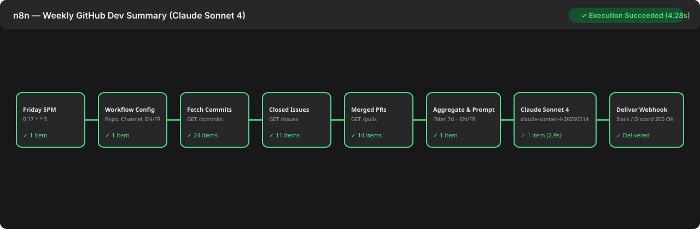

# n8n + Claude (`claude-sonnet-4-20250514`) Automated Weekly Dev Summary

An exportable, ready-to-import **n8n workflow** ([`workflow.json`](./workflow.json)) that runs every **Friday at 5:00 PM UTC** (`0 17 * * 5`), fetches the past 7 days of **commits, closed issues, and merged pull requests** from a target GitHub repository, synthesizes an executive narrative via the **Claude API (`claude-sonnet-4-20250514`)**, and delivers the digest to a **Slack or Discord webhook** in either **English (`EN`)** or **French (`FR`)**.

---

## Setup in 5 Steps

1. **Import Workflow**: In your n8n dashboard, click **Workflows → Add Workflow → Import from File...** and select [`workflow.json`](./workflow.json).
2. **Set API Keys**: Configure environment variables `GITHUB_TOKEN` (GitHub PAT with `repo` / `public_repo` read access) and `ANTHROPIC_API_KEY` (Anthropic API key).
3. **Configure Variables**: Open the **`Workflow Config (Repo, Channel, EN/FR)`** node (or set via environment variables):
   - `github_repo`: e.g. `Parabola-org/parabola` (env: `GITHUB_REPO`)
   - `destination_channel`: e.g. `#eng-weekly-digest` (env: `DESTINATION_CHANNEL`)
   - `language`: `EN` or `FR` (env: `SUMMARY_LANGUAGE`)
4. **Set Webhook URL**: Set `webhook_url` (or `SUMMARY_WEBHOOK_URL`) to your incoming **Slack Webhook URL** (`https://hooks.slack.com/services/...`) or **Discord Webhook URL** (`https://discord.com/api/webhooks/...`). Both payload keys (`text` for Slack and `content` for Discord) are sent automatically.
5. **Test & Activate**: Click **Test Workflow** to verify immediate delivery, then toggle **Active** in the top-right corner to enable the Friday 5:00 PM cron schedule.

---

## Workflow Architecture

| Step | Node Name | Type | Description |
| :--- | :--- | :--- | :--- |
| 1 | `Weekly Friday 5PM Trigger` | `n8n-nodes-base.scheduleTrigger` | Fires every Friday at `17:00` (`0 17 * * 5`) |
| 2 | `Workflow Config (Repo, Channel, EN/FR)` | `n8n-nodes-base.set` | Defines `github_repo`, `destination_channel`, `webhook_url`, `language` (`EN`/`FR`), and 7-day `since_iso` |
| 3 | `Fetch Weekly Commits` | `n8n-nodes-base.httpRequest` | Queries `GET /repos/{owner}/{repo}/commits?since={since_iso}` |
| 4 | `Fetch Closed Issues` | `n8n-nodes-base.httpRequest` | Queries `GET /repos/{owner}/{repo}/issues?state=closed&since={since_iso}` |
| 5 | `Fetch Merged PRs` | `n8n-nodes-base.httpRequest` | Queries `GET /repos/{owner}/{repo}/pulls?state=closed&sort=updated` |
| 6 | `Aggregate Activity & Build Prompt` | `n8n-nodes-base.code` | Filters PRs merged in the 7-day window, deduplicates issues vs. PRs, and formats the `EN`/`FR` prompt |
| 7 | `Generate Narrative Summary` | `n8n-nodes-base.httpRequest` | Calls `POST https://api.anthropic.com/v1/messages` with `model: "claude-sonnet-4-20250514"` |
| 8 | `Deliver Summary (Slack / Discord Webhook)` | `n8n-nodes-base.httpRequest` | Delivers the formatted Markdown digest to Slack or Discord |
